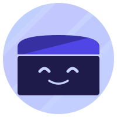

<div align="center"><a name="readme-top"></a>



# Mimik RU

[Русский](../../README.md) · **English** · [Español](./README.es.md) · [Português (BR)](./README.pt-BR.md) · [Français](./README.fr.md) · [简体中文](./README.zh-CN.md)

**Auto-capture any browser workflow into a step-by-step guide. No account, no cloud, no tracking.**

Click record, do the thing, get a polished guide with annotated screenshots. Narrate it as you go, edit it after, then replay or export.

> **This is a fork.** Mimik RU is an independent fork of [Mimik][upstream-link] by Westpoint (MIT). The original ships through the Chrome, Firefox and Edge stores; this build ships as files in [Releases][releases-link]. Upstream changes are merged into `dev` regularly.

[![License][license-shield]][license-link]
[![Release][releases-shield]][releases-link]
[![Manifest V3][mv3-shield]][mv3-link]
[![100% Local][local-shield]][local-link]

</div>

## 👋 Getting started

Mimik turns any repetitive browser task into a documented, shareable guide in seconds. It runs entirely in your browser. No backend, no account, no telemetry, and nothing ever leaves your device.

Every meaningful action becomes a step: clicks on buttons and links, form inputs, keyboard shortcuts, clipboard actions, drag events, and page navigations. Each step gets a screenshot with the clicked element highlighted and zoomed in, so there is no manual cropping to do.

Need the recording to look away for a moment? **Pause** stops capture without ending the recording, and **Resume** picks up where you left off.

### Install

Mimik RU ships as files, outside the stores:

| File | For |
| --- | --- |
| `mimik-ru-<version>-chrome.zip` | Chrome and other Chromium browsers (Edge, Brave, Arc) |
| `mimik-ru-<version>-firefox.zip` | Firefox 128 and newer |
| `mimik-ru-<version>-sources.zip` | The build sources |
| `SHA256SUMS.txt` | Checksums of the archives |

**Chrome / Chromium:**

1. Open [Releases][releases-link] and download `mimik-ru-<version>-chrome.zip`.
2. Unzip it into a folder you will not delete or move: Chrome ties the extension to that path, and moving it leaves the guide library empty.
3. Open `chrome://extensions`, turn on **Developer mode** and click **Load unpacked**, picking the folder with `manifest.json`.

Edge works the same way on `edge://extensions`.

**Firefox:**

1. Download and unzip `mimik-ru-<version>-firefox.zip`.
2. Open `about:debugging#/runtime/this-firefox`, click **Load Temporary Add-on** and pick `manifest.json` from the unzipped folder.

A temporary add-on lives until the browser restarts. A permanent install needs Developer Edition or ESR with signature checks off.

The interface is available in English, Spanish, Brazilian Portuguese, French, German, Russian, Japanese, Korean, Simplified Chinese and Traditional Chinese. The AI description language is set separately, so you can run Mimik in Russian and generate guides in English, or any combination.

## ✨ Features

### 🔒 Smart blur

Smart blur is a mode you enter while recording, not an always-on filter. Click **Smart blur** and capture pauses, Mimik detects and masks sensitive data on the page — emails, phone numbers, SSNs, credit cards, IP addresses, MAC addresses — and screenshots of that page keep it hidden once you click **Done**.

It does not reach iframes, shadow DOM, CSS `::before`/`::after`, `<select>` text, or text painted into canvases and images, and it only scans the top frame of the tab you are on. Check screenshots that matter rather than trusting a clean one.

### 🧠 AI descriptions (optional)

Bring your own key and Mimik writes human-readable step descriptions instead of the rule-based `Click Submit`. Supported providers: OpenAI, Anthropic, DeepSeek, OpenRouter, and any OpenAI- or Anthropic-compatible server of your own — Ollama, LM Studio, vLLM, LiteLLM. A bare server address is completed to `/v1`, and a local reasoning model is asked to answer without reasoning so the budget is not spent on an empty reply.

Descriptions are generated from a lightweight DOM context (~50-100 tokens), not screenshots — roughly 15-30x cheaper than vision models. The description language is picked separately (ten languages, Russian included), and the prompts Mimik sends can be viewed and edited in **AI prompts**, with room for your own instructions.

### 🗂 Recording card and shortcuts

While recording, the page shows a card with the last captured step, pause, finish and add-step buttons, and a counter. Drag it anywhere so it does not cover what you need.

| Keys | Action |
| --- | --- |
| `Alt+Shift+1` | Start or finish recording |
| `Alt+Shift+2` | Pause and resume |
| `Alt+Shift+3` | Capture a step without a click — for open menus |

Shortcuts are changed on the extension's own page: the browser keeps them.

### ▶️ Guide Me replay

Replay any guide live on a real page. Mimik highlights the next element to click, tracks your progress step by step, and advances automatically as you interact.

### 🎙️ Voice narration (optional)

Talk through the workflow while you record and Mimik turns what you said into step descriptions. Audio is transcribed with your own key (OpenAI or Groq) and matched to the steps it belongs to. The full transcript is kept and stays on your device; editing a step never destroys the spoken original.

### ✏️ Guide editor

Crop, annotate and redact any screenshot, rewrite a step with AI inline, add headings and notes between steps, reorder steps from the contents panel, copy selected steps to another guide, delete in bulk and roll back through version history.

### 🌙 Dark theme

Follows the system setting or the choice saved in Mimik's settings.

### 🔊 Video voice-over (optional)

Turn it on in the export panel and every step of a video export is read aloud with your own OpenAI or ElevenLabs key. An OpenAI key already set for AI descriptions is reused. Narrated steps hold on screen until the voice finishes, and clips are cached locally.

### 📤 Multi-format export

- **Video**: mp4/H.264 with the cursor moving to each target and numbered steps, optionally narrated
- **GIF**: a short looping clip
- **PDF**: print-ready A4
- **DOCX**: keep editing in Word
- **HTML**: self-contained, images embedded as base64
- **Markdown**: paste into Notion, GitHub or a wiki
- **Mimik file**: the only format that imports back

Everything is generated client-side.

### 📦 Share a guide

Export a guide as a `.mimik` file and someone else can import it with the same steps, screenshots and replay. Blurred areas are burnt into the pixels, typed field text is removed from step text and links, and links are trimmed to the page address by default. Screenshots still show what was on screen — blur anything sensitive the camera caught.

## 🔐 Privacy & storage

Guides, steps and screenshots live on your device. There is no backend, no account and no telemetry. API keys are stored locally and used to call the provider you chose directly.

Two things leave the browser, both documented in the [privacy policy](../../PRIVACY.md): site icons come from Google's favicon service, which receives the site's domain, and the optional AI, narration and voice-over features send text or audio to the provider you configured. The original project's policy is at [mimik.westpoint.io/privacy](https://mimik.westpoint.io/privacy/).

## 🛠 Development

Node.js 22 and pnpm 10 are required.

```bash
pnpm install
pnpm dev          # Chrome
pnpm dev:firefox  # Firefox
pnpm build
pnpm zip:all      # Chrome and Firefox archives in apps/extension/.output
pnpm test
pnpm typecheck
pnpm lint
```

The project is a monorepo: `apps/extension` (the extension), `apps/desktop` (upstream's desktop app), `packages/core` (shared logic), `packages/ui` (interface), `packages/locales` (translations). Architecture notes live in [AGENTS.md](../../AGENTS.md).

## 🤝 Contributing

Bug reports, ideas and pull requests are welcome. Read [CONTRIBUTING.md](../../CONTRIBUTING.md) first for the setup, project layout and contributor rules.

## 📜 License

MIT © [Westpoint](https://github.com/westpoint-io). See [LICENSE](../../LICENSE) for details.

<div align="right">

[Back to top](#readme-top)

</div>

<!-- LINK GROUP -->

[license-shield]: https://img.shields.io/badge/license-MIT-4F46E5?style=flat-square&labelColor=1E1B4B
[license-link]: ../../LICENSE

[mv3-shield]: https://img.shields.io/badge/manifest-v3-3730A3?style=flat-square&labelColor=1E1B4B
[mv3-link]: https://developer.chrome.com/docs/extensions/mv3/intro/

[local-shield]: https://img.shields.io/badge/storage-100%25%20local-4F46E5?style=flat-square&labelColor=1E1B4B
[local-link]: #-privacy--storage

[releases-shield]: https://img.shields.io/github/v/release/arklochkow/mimik?style=flat-square&label=release&color=4F46E5&labelColor=1E1B4B
[releases-link]: https://github.com/arklochkow/mimik/releases

[upstream-link]: https://github.com/westpoint-io/mimik
