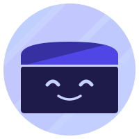

<div align="center"><a name="readme-top"></a>



# Mimik RU

**Русский** · [English](.github/readme/README.en.md) · [Español](.github/readme/README.es.md) · [Português (BR)](.github/readme/README.pt-BR.md) · [Français](.github/readme/README.fr.md) · [简体中文](.github/readme/README.zh-CN.md)

**Автоматически превращайте любой сценарий работы в браузере в пошаговый гайд. Без аккаунта, без облака, без слежки.**

Нажмите запись, сделайте что нужно — и получите аккуратный гайд с аннотированными скриншотами. Озвучивайте по ходу, редактируйте после, а затем воспроизводите или экспортируйте.

> **Это форк.** Mimik RU — самостоятельный форк [Mimik][upstream-link] от Westpoint (лицензия MIT). Оригинал распространяется через магазины Chrome, Firefox и Edge; эта сборка — файлами из [Releases][releases-link]. Изменения из upstream регулярно вливаются в ветку `dev`.

<!-- SHIELD GROUP -->

[![License][license-shield]][license-link]
[![Release][releases-shield]][releases-link]
[![Manifest V3][mv3-shield]][mv3-link]
[![100% Local][local-shield]][local-link]
[![No Account][no-account-shield]][no-account-link]
<br/>
[![Stars][star-shield]][star-link]
[![Contributors][contributors-shield]][contributors-link]
![Last Commit][last-commit-shield]
[![Issues][issues-shield]][issues-link]

</div>

<details>
<summary><kbd>Содержание</kbd></summary>

#### TOC

- [📺 Демонстрация](#-демонстрация)
- [👋 Начало работы](#-начало-работы)
  - [Установка](#-установка)
- [✨ Возможности](#-возможности)
  - [🔒 Smart Blur](#-smart-blur)
  - [🧠 AI-описания (необязательно)](#-ai-описания-необязательно)
  - [🗂 Карточка записи и горячие клавиши](#-карточка-записи-и-горячие-клавиши)
  - [▶️ Воспроизведение «Покажи, как»](#️-воспроизведение-покажи-как)
  - [🎙️ Озвучка записи (необязательно)](#️-озвучка-записи-необязательно)
  - [✏️ Редактор гайдов](#️-редактор-гайдов)
  - [🌙 Тёмная тема](#-тёмная-тема)
  - [🔊 Озвучка видео (необязательно)](#-озвучка-видео-необязательно)
  - [📤 Экспорт в разные форматы](#-экспорт-в-разные-форматы)
  - [📦 Поделиться гайдом](#-поделиться-гайдом)
- [🔐 Приватность и хранение](#-приватность-и-хранение)
- [🛠 Разработка](#-разработка)
- [🤝 Участие](#-участие)
- [📜 Лицензия](#-лицензия)

<br/>

</details>

## 📺 Демонстрация

https://github.com/user-attachments/assets/f71f5898-ee5e-4b22-b9fd-d5b45af73459

## 👋 Начало работы

Mimik за секунды превращает любую повторяющуюся задачу в браузере в задокументированный гайд, которым можно поделиться. Всё работает прямо в вашем браузере. Ни бэкенда, ни аккаунта, ни телеметрии — ничего не покидает ваше устройство.

Документируете ли вы внутренние инструменты, пишете ли обучающие материалы по продукту или вводите в курс коллегу — Mimik сам записывает каждый клик, нажатие клавиши и переход, чтобы вы занимались делом.

Каждое значимое действие становится шагом: клики по кнопкам и ссылкам, ввод в поля, горячие клавиши, работа с буфером обмена, перетаскивание и переходы по страницам. Быстрые клики по соседним элементам объединяются, чтобы гайды оставались чистыми, а клик перехватывается до того, как страница уйдёт на новую — поэтому ничего не теряется ни в SPA, ни при полной загрузке страницы.

Каждый шаг получает скриншот с подсвеченным и увеличенным элементом, по которому вы кликнули. Никакого ручного кадрирования и никаких инструментов аннотаций, которые нужно осваивать.

Нужно, чтобы запись на мгновение отвернулась? **Пауза** останавливает захват, не завершая запись, а **Продолжить** возобновляет её с того же места. Вход в Smart Blur ставит её на паузу точно так же.

### Установка

Mimik RU распространяется файлами, вне магазинов:

| Файл | Для чего |
| --- | --- |
| `mimik-ru-<версия>-chrome.zip` | Chrome и другие браузеры на Chromium (Edge, Brave, Arc) |
| `mimik-ru-<версия>-firefox.zip` | Firefox 128 и новее |
| `mimik-ru-<версия>-sources.zip` | Исходники сборки |
| `SHA256SUMS.txt` | Контрольные суммы архивов |

**Chrome / Chromium:**

1. Откройте [Releases][releases-link] и скачайте `mimik-ru-<версия>-chrome.zip`.
2. Распакуйте архив в папку, которую не будете удалять или переносить: Chrome привязывает расширение к её пути, и после переноса библиотека гайдов окажется пустой.
3. Откройте `chrome://extensions`, включите **Режим разработчика** и нажмите **Загрузить распакованное**, выбрав папку с `manifest.json`.

В Edge шаги те же, страница — `edge://extensions`.

**Firefox:**

1. Скачайте `mimik-ru-<версия>-firefox.zip` и распакуйте его.
2. Откройте `about:debugging#/runtime/this-firefox`, нажмите **Загрузить временное дополнение** и выберите `manifest.json` из распакованной папки.

Временное дополнение в Firefox живёт до перезапуска браузера. Для постоянной установки нужен Developer Edition или ESR с отключённой проверкой подписи.

Доступно на английском, испанском, бразильском португальском, французском, немецком, русском, японском, корейском, упрощённом и традиционном китайском. Язык AI-описаний настраивается отдельно, поэтому интерфейс может быть русским, а гайды — на английском, или любая другая комбинация.

> \[!IMPORTANT]
>
> **⭐️ Поставьте звезду репозиторию**, если Mimik экономит вам время. Так о нём узнают другие.

<div align="right">

[![Back to top][back-to-top]](#readme-top)

</div>

## ✨ Возможности

### 🔒 Smart Blur

Smart Blur — это режим, в который вы входите во время записи, а не постоянно включённый фильтр. Нажмите **Умное размытие** — захват приостановится, Mimik найдёт и замаскирует конфиденциальные данные на странице (почту, телефоны, номера соцстрахования, банковские карты, IP- и MAC-адреса), и скриншоты этой страницы останутся скрытыми после нажатия **Готово**. Каждую категорию можно включать отдельно.

Нужно размыть что-то своё? Ручной режим размытия позволяет выбрать любой элемент DOM и замаскировать его на всех скриншотах, где он встречается.

<details>
<summary><strong>Что Smart Blur не покрывает</strong></summary>

<br/>

Smart Blur работает, сканируя текстовые узлы и значения полей в верхнем фрейме страницы. Из-за этого остаются реальные пробелы, и все они структурные. Если вы полагаетесь на него ради GDPR или аналогичных требований, проверяйте скриншоты, а не считайте чистый скриншот безопасным:

| Не покрывается | Почему |
|----------------|--------|
| Содержимое внутри iframe | Полностью пропускается; кросс-доменные фреймы недоступны со страницы |
| Shadow DOM | Сканирование обходит документ и не спускается в теневые корни |
| Текст, нарисованный на `<canvas>`, и текст внутри изображений | Это пиксели, а не текст |
| Содержимое CSS `::before` / `::after` | Это не текстовый узел |
| Текст `<select>` и `<option>` | Исключён из сканирования |
| Значения, хранящиеся только в атрибутах, например `title` или `alt` | Сканируются только текстовые узлы и значения полей |
| Фреймы, кроме верхнего | Оверлей и сканирование работают только в верхнем фрейме |
| Любая вкладка, кроме той, где вы вошли в режим | Сканируется только она; вторая вкладка с тем же приложением — нет |
| Текст, появившийся после нажатия **Готово** | Сканирование останавливается вместе с оверлеем, поэтому повторный рендер в SPA, следующая страница списка или переход останутся без маски — войдите в режим размытия снова |

О двух вещах, которые *всё-таки* обрабатываются, стоит знать: совпадение внутри SVG `<text>` удаляется из отрисовки, а не размывается, потому что маска — это HTML-элемент, который SVG не нарисует. Данные не утекают, но они исчезают, а не размываются. А подходящие `<input>` или `<textarea>` размываются **целиком**, а не только по совпавшей подстроке.

Размытие действует с момента входа в режим и далее. Скриншоты, снятые до этого, задним числом не маскируются — удалите эти шаги в редакторе.

</details>

<div align="right">

[![Back to top][back-to-top]](#readme-top)

</div>

### 🧠 AI-описания (необязательно)

Подключите свой API-ключ, и Mimik будет генерировать понятные описания шагов вроде *«Нажмите кнопку **Сохранить**, чтобы сохранить изменения»* вместо шаблонного `Кликните Сохранить`.

Поддерживаются OpenAI, Anthropic, DeepSeek, OpenRouter и любой собственный сервер, совместимый с OpenAI или Anthropic: Ollama, LM Studio, vLLM, LiteLLM. Для своего сервера можно задать базовый адрес и дополнительные заголовки; адрес без пути автоматически дополняется `/v1`. Если у локальной модели есть режим размышлений, Mimik попросит её отвечать без них — иначе весь лимит уходит на reasoning и шаг остаётся без описания.

Описания строятся на лёгком контексте DOM (~50-100 токенов), а не на скриншотах. Это примерно в 15-30 раз дешевле, чем модели зрения. Язык описаний выбирается отдельно (десять языков, включая русский).

Что и как спрашивать у модели, можно посмотреть и поправить: в настройках есть раздел **AI-промпты** с текстом Mimik и полем для своих инструкций. Без ключа шаги получают простые описания по правилам — запись работает и так.

<div align="right">

[![Back to top][back-to-top]](#readme-top)

</div>

### 🗂 Карточка записи и горячие клавиши

Во время записи на странице показывается карточка: последний снятый шаг, кнопки паузы, завершения и добавления шага, а также счётчик. Карточку можно перетащить в любое место, чтобы она не закрывала нужное.

Горячие клавиши по умолчанию:

| Клавиши | Действие |
| --- | --- |
| `Alt+Shift+1` | Начать или завершить запись |
| `Alt+Shift+2` | Пауза и продолжение |
| `Alt+Shift+3` | Снять шаг без клика — для открытых меню и выпадающих списков |

Сочетания меняются на странице расширения: браузер хранит их у себя.

<div align="right">

[![Back to top][back-to-top]](#readme-top)

</div>

### ▶️ Воспроизведение «Покажи, как»

Воспроизводите любой гайд прямо на настоящей странице. Mimik подсвечивает следующий элемент, по которому нужно кликнуть, отслеживает ваш прогресс шаг за шагом и переходит дальше автоматически по мере ваших действий. Идеально, чтобы вводить в курс коллег или пройти процесс самостоятельно.

<div align="right">

[![Back to top][back-to-top]](#readme-top)

</div>

### 🎙️ Озвучка записи (необязательно)

Проговаривайте сценарий вслух во время записи, и Mimik превратит сказанное в описания шагов. Аудио распознаётся вашим собственным ключом (OpenAI или Groq) и сопоставляется с шагами, к которым относится, — так вы озвучиваете один раз вместо того, чтобы вручную писать каждый шаг.

Сохраняется вся расшифровка, а не только те части, что попали в шаг. Откройте **Расшифровку** у гайда, чтобы увидеть всё сказанное, включая строки, которым не нашлось пары, и добавить любую из них в шаг. Редактирование шага тоже никогда не уничтожает произнесённый оригинал — редактор шага всегда может вернуть то, что вы на самом деле сказали. Расшифровка остаётся на вашем устройстве, никогда не попадает в экспортируемый гайд и удаляется вместе с ним.

<div align="right">

[![Back to top][back-to-top]](#readme-top)

</div>

### ✏️ Редактор гайдов

Исправьте гайд после записи, не записывая его заново. Обрезайте, аннотируйте и заштриховывайте любой скриншот, переписывайте шаг с помощью AI прямо на месте, вставляйте заголовки и примечания между шагами, меняйте порядок или удаляйте пачкой и откатывайтесь по истории версий.

Шаги можно переставлять из панели содержания, не перетаскивая карточки, и копировать выбранные шаги в другой гайд — вместе со скриншотами.

<div align="right">

[![Back to top][back-to-top]](#readme-top)

</div>

### 🌙 Тёмная тема

Тёмная тема следует системной настройке или выбору, сохранённому в настройках Mimik. Переключатель — в разделе оформления.

<div align="right">

[![Back to top][back-to-top]](#readme-top)

</div>

### 🔊 Озвучка видео (необязательно)

Включите её в панели экспорта — и каждый шаг видео будет прочитан вслух вашим собственным ключом OpenAI или ElevenLabs. Если ключ OpenAI уже задан для AI-описаний, Mimik переиспользует его: больше нигде регистрироваться не нужно. Озвученные шаги держатся на экране, пока не закончится голос, поэтому ничего не обрывается, а клипы кэшируются локально, так что повторный экспорт того же гайда ничего не стоит.

По умолчанию выключено: наличие ключа никогда не включает озвучку — её включаете вы.

<div align="right">

[![Back to top][back-to-top]](#readme-top)

</div>

### 📤 Экспорт в разные форматы

Делитесь гайдами в том формате, который подходит вашему процессу:

- **Видео**: озвученный обход, mp4/H.264, с курсором, движущимся к каждой цели, и нумерацией шагов — при желании с голосовым сопровождением OpenAI или ElevenLabs, читающим каждый шаг вслух, что также делает экспорт пригодным по Section 508
- **GIF**: короткий зацикленный клип для переписки или комментария к задаче
- **PDF**: готовый к печати, A4 книжной ориентации с автоматическими разрывами страниц
- **DOCX**: открывайте и продолжайте редактировать в Word
- **HTML**: самодостаточный, делитесь где угодно, изображения встроены в base64
- **Markdown**: вставляйте в Notion, GitHub, внутреннюю документацию, вики
- **Файл Mimik**: единственный формат, который импортируется обратно — см. [Поделиться гайдом](#-поделиться-гайдом) ниже

Все экспорты генерируются на стороне клиента. Ничего не касается сервера.

<div align="right">

[![Back to top][back-to-top]](#readme-top)

</div>

### 📦 Поделиться гайдом

Экспортируйте гайд как **файл `.mimik`** — и кто угодно сможет импортировать его в свой Mimik: те же шаги, те же скриншоты, всё ещё редактируемые и всё ещё воспроизводимые через «Покажи, как». Это обычный zip: манифест, скриншоты и `README.md`, чтобы файл читался как документ даже без расширения.

Он передаётся как файл, поэтому делиться им можно любым привычным способом: отправить почтой, скинуть в Slack, закоммитить в репозиторий. Ни аккаунта, ни сервера для этого не нужно.

Поскольку в гайде может оказаться больше, чем вы собирались отправить, экспорт сам решает, что уходит наружу:

- **Размытые области впекаются в пиксели** до того, как файл записан, поэтому получателю нечего размывать обратно.
- **Введённый вами в поля текст удаляется** из текста шагов, названия и ссылок, а не только из сохранённого значения.
- **Ссылки по умолчанию урезаются до адреса страницы**, отбрасывая строки запроса, которые несут токены сессии.

Скриншоты по-прежнему показывают то, что было на экране в момент съёмки — используйте размытие для всего чувствительного, что попало в кадр.

Чтобы импортировать, откройте панель и нажмите **Импорт** или перетащите файл `.mimik` в свою библиотеку. Перед добавлением вы увидите, что удалил отправитель.

<div align="right">

[![Back to top][back-to-top]](#readme-top)

</div>

## 🔐 Приватность и хранение

Гайды, шаги и скриншоты живут на вашем устройстве. Ни бэкенда, ни аккаунта, ни телеметрии. Ваши API-ключи (если вы их подключите) никогда не покидают браузер: они хранятся локально и используются для прямых запросов к выбранному вами провайдеру.

Если вы маскируете персональные данные перед тем, как поделиться гайдом, сначала прочитайте, [что Smart Blur не покрывает](#-smart-blur): он не дотягивается до iframe, shadow DOM и текста, нарисованного на изображениях.

Из браузера выходят две вещи, обе описаны в [политике конфиденциальности](./PRIVACY.md): иконки сайтов запрашиваются у сервиса фавиконов Google, которому передаётся домен этого сайта, а необязательные функции AI, озвучки записи и озвучки видео отправляют текст или аудио настроенному вами провайдеру — озвучка видео отправляет текст каждого шага в момент экспорта и только когда вы её включили. Политика оригинала — [mimik.westpoint.io/privacy](https://mimik.westpoint.io/privacy/).

<div align="right">

[![Back to top][back-to-top]](#readme-top)

</div>

## 🛠 Разработка

Нужны Node.js 22 и pnpm 10.

```bash
pnpm install
pnpm dev          # Chrome
pnpm dev:firefox  # Firefox
pnpm build
pnpm zip:all      # архивы для Chrome и Firefox в apps/extension/.output
pnpm test
pnpm typecheck
pnpm lint
```

Проект — монорепозиторий: `apps/extension` (расширение), `apps/desktop` (десктопное приложение upstream), `packages/core` (общая логика), `packages/ui` (интерфейс), `packages/locales` (переводы). Правила для агентов и описание архитектуры — в [AGENTS.md](./AGENTS.md).

<div align="right">

[![Back to top][back-to-top]](#readme-top)

</div>

## 🤝 Участие

Багрепорты, идеи и пул-реквесты приветствуются. Перед изменениями прочитайте [CONTRIBUTING.md](./CONTRIBUTING.md) — там настройка окружения, устройство проекта и правила для контрибьюторов.

<div align="right">

[![Back to top][back-to-top]](#readme-top)

</div>

## 📜 Лицензия

MIT © [Westpoint](https://github.com/westpoint-io). Подробности в [LICENSE](./LICENSE).

<div align="right">

[![Back to top][back-to-top]](#readme-top)

</div>

<!-- LINK GROUP -->

[back-to-top]: https://img.shields.io/badge/-BACK_TO_TOP-1E1B4B?style=flat-square

[license-shield]: https://img.shields.io/badge/license-MIT-4F46E5?style=flat-square&labelColor=1E1B4B
[license-link]: ./LICENSE

[mv3-shield]: https://img.shields.io/badge/manifest-v3-3730A3?style=flat-square&labelColor=1E1B4B
[mv3-link]: https://developer.chrome.com/docs/extensions/mv3/intro/

[local-shield]: https://img.shields.io/badge/storage-100%25%20local-4F46E5?style=flat-square&labelColor=1E1B4B
[local-link]: #-приватность-и-хранение

[no-account-shield]: https://img.shields.io/badge/account-not%20required-4F46E5?style=flat-square&labelColor=1E1B4B
[no-account-link]: #-приватность-и-хранение

[star-shield]: https://img.shields.io/github/stars/arklochkow/mimik?style=flat-square&label=stars&color=4F46E5&labelColor=1E1B4B
[star-link]: https://github.com/arklochkow/mimik/stargazers

[contributors-shield]: https://img.shields.io/github/contributors/arklochkow/mimik?style=flat-square&labelColor=1E1B4B
[contributors-link]: https://github.com/arklochkow/mimik/graphs/contributors

[last-commit-shield]: https://img.shields.io/github/last-commit/arklochkow/mimik?style=flat-square&label=commit&labelColor=1E1B4B

[issues-shield]: https://img.shields.io/github/issues/arklochkow/mimik?style=flat-square&labelColor=1E1B4B
[issues-link]: https://github.com/arklochkow/mimik/issues

[releases-shield]: https://img.shields.io/github/v/release/arklochkow/mimik?style=flat-square&label=release&color=4F46E5&labelColor=1E1B4B
[releases-link]: https://github.com/arklochkow/mimik/releases

[upstream-link]: https://github.com/westpoint-io/mimik
